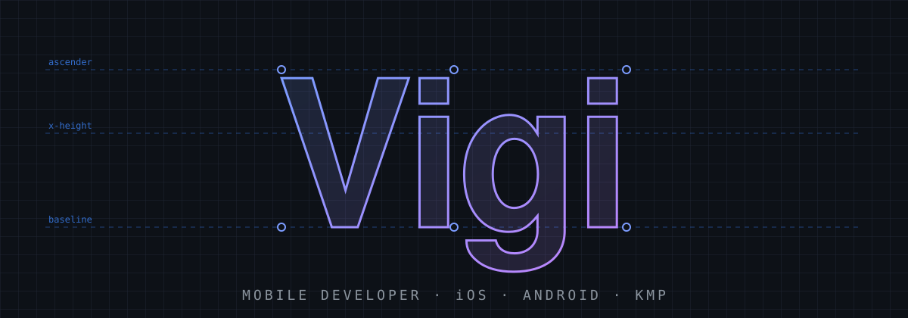

<table>
  <tr>
    <td colspan="2">
      <b>👋 Hey! I'm Vikri — Mobile Developer</b>
      
    </td>
  </tr>
  <tr>
    <td colspan="2"></td>
  </tr>
  <tr>
    <td colspan="2">
      <b>Languages</b> 
      
      
      
      
      
    </td>
  </tr>
  <tr>
    <td colspan="2">
      <b>Mobile</b> 
      
      
      
      
      
      
    </td>
  </tr>
  <tr>
    <td colspan="2">
      <b>Web</b> 
      
      
      
      
    </td>
  </tr>
  <tr>
    <td colspan="2">
      <b>Backend</b> 
      
      
      
      
      
      
    </td>
  </tr>
</table>
